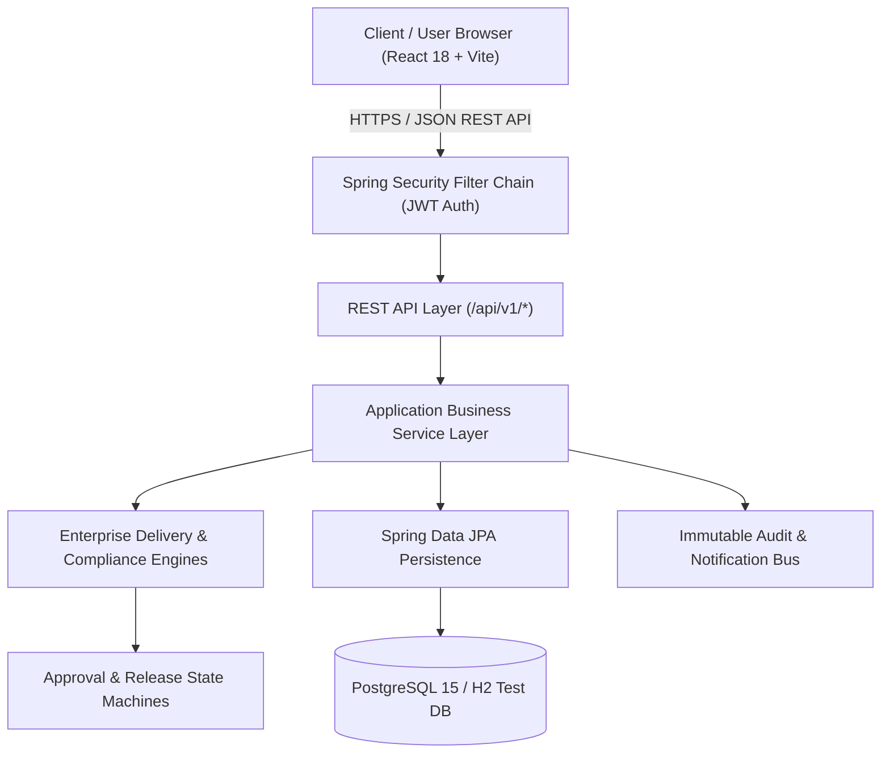

# DevFlow Architecture & System Design

## 1. High-Level Architectural Pattern

DevFlow is designed as a modular monolith leveraging Spring Boot 3 on the backend and React 18 on the frontend. This architecture ensures high cohesion, rapid local development without container orchestration complexity, and straightforward scaling to containerized or distributed deployments.

## 2. Backend Layered Architecture

1. **Presentation & Security Layer (`com.devflow.controller`, `com.devflow.security`)**:
   - Stateless JWT authentication via `JwtAuthenticationFilter`.
   - Method-level role authorization (`@PreAuthorize("hasRole('ADMIN')")`).
   - Standardized API envelope responses with error handling advice (`@ControllerAdvice`).

2. **Domain Service & Orchestration Layer (`com.devflow.service`, `com.devflow.engine`)**:
   - **ApprovalWorkflowEngine**: Manages multi-stage client approval, revision requests, and version locking.
   - **ReleaseReadinessGatekeeper**: Evaluates real-time compliance matrices (test pass rates $\ge 90\%$, zero blocker/critical defects, 100% mandatory sign-offs).
   - **TraceabilityMatrixEngine**: Bridges requirements $\rightarrow$ tasks $\rightarrow$ tests $\rightarrow$ deliverables.

3. **Data Access & Entity Layer (`com.devflow.domain`, `com.devflow.repository`)**:
   - Normalized JPA entities with optimistic locking (`@Version`).
   - Audited entities tracking `createdAt`, `updatedAt`, `createdBy`, `updatedBy`.
   - Spring Data JPA repositories with custom JPQL queries and pagination.

## 3. Frontend Architecture

1. **Design System & Visual Canvas**:
   - Palette: Warm Ivory (`#FBF9F5`), Terracotta (`#E05A47`), Deep Charcoal (`#1F2421`), Emerald (`#2E7D32`), Amber (`#D97706`).
   - Lucide Icons for unambiguous visual semantics.

2. **Route Hierarchy & State Management**:
   - Public Routes: Landing page, Login, Registration, Password Reset.
   - Protected Routes with Role Guards:
     - `/app/dashboard`: Executive delivery metrics and project health.
     - `/app/projects`: Project roster and milestone roadmaps.
     - `/app/kanban`: Interactive drag-and-drop task boards.
     - `/app/requirements`: Specification coverage and traceability.
     - `/app/deliverables`: Version registry and asset records.
     - `/app/client-portal`: Isolated client review & sign-off center.
     - `/app/qa`: Test plans, test execution runs, and defect triage.
     - `/app/releases`: Release checklist gatekeeper and deployment manifests.
     - `/app/reports`: Productivity, velocity, and compliance analytics.
     - `/app/audit`: Immutable activity ledger.
