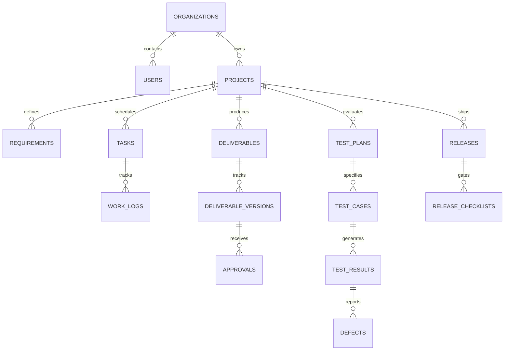

# DevFlow Database Schema & Architecture

## Overview
DevFlow uses a relational schema designed for strict multi-tenancy, data integrity, and compliance auditability. Supported databases: **PostgreSQL 14+** (production) and **H2** (in-memory test suite).

---

## Entity Relationship Diagram Overview

---

## Table Specifications

### 1. `users`
- `id` (UUID / BIGINT PRIMARY KEY)
- `email` (VARCHAR(255) UNIQUE NOT NULL)
- `password_hash` (VARCHAR(255) NOT NULL)
- `full_name` (VARCHAR(150) NOT NULL)
- `role` (VARCHAR(50) NOT NULL: ADMIN, PROJECT_MANAGER, DEVELOPER, QA_TESTER, CLIENT)
- `organization_id` (BIGINT REFERENCES organizations(id))
- `is_active` (BOOLEAN DEFAULT TRUE)
- `created_at`, `updated_at` (TIMESTAMP WITH TIME ZONE)

### 2. `organizations`
- `id` (BIGINT PRIMARY KEY GENERATED ALWAYS AS IDENTITY)
- `name` (VARCHAR(150) NOT NULL)
- `slug` (VARCHAR(100) UNIQUE NOT NULL)
- `plan_tier` (VARCHAR(50) DEFAULT 'ENTERPRISE')
- `created_at`, `updated_at` (TIMESTAMP WITH TIME ZONE)

### 3. `organization_members`
- `id` (BIGINT PRIMARY KEY GENERATED ALWAYS AS IDENTITY)
- `organization_id` (BIGINT REFERENCES organizations(id))
- `user_id` (BIGINT REFERENCES users(id))
- `member_role` (VARCHAR(50) NOT NULL)
- `joined_at` (TIMESTAMP WITH TIME ZONE)

### 4. `projects`
- `id` (BIGINT PRIMARY KEY GENERATED ALWAYS AS IDENTITY)
- `organization_id` (BIGINT REFERENCES organizations(id) NOT NULL)
- `project_key` (VARCHAR(20) NOT NULL)
- `name` (VARCHAR(200) NOT NULL)
- `description` (TEXT)
- `status` (VARCHAR(50) DEFAULT 'ACTIVE')
- `priority` (VARCHAR(30) DEFAULT 'MEDIUM')
- `health_status` (VARCHAR(30) DEFAULT 'ON_TRACK')
- `start_date`, `target_delivery_date` (DATE)
- `created_at`, `updated_at` (TIMESTAMP WITH TIME ZONE)

### 5. `project_members`
- `id` (BIGINT PRIMARY KEY GENERATED ALWAYS AS IDENTITY)
- `project_id` (BIGINT REFERENCES projects(id) ON DELETE CASCADE)
- `user_id` (BIGINT REFERENCES users(id) ON DELETE CASCADE)
- `assigned_role` (VARCHAR(50) NOT NULL)
- `assigned_at` (TIMESTAMP WITH TIME ZONE)

### 6. `requirements`
- `id` (BIGINT PRIMARY KEY GENERATED ALWAYS AS IDENTITY)
- `project_id` (BIGINT REFERENCES projects(id) ON DELETE CASCADE)
- `req_code` (VARCHAR(30) NOT NULL)
- `title` (VARCHAR(255) NOT NULL)
- `acceptance_criteria` (TEXT NOT NULL)
- `priority` (VARCHAR(30) DEFAULT 'HIGH')
- `status` (VARCHAR(50) DEFAULT 'DRAFT')
- `coverage_ratio` (NUMERIC(5,2) DEFAULT 0.0)
- `created_at`, `updated_at` (TIMESTAMP WITH TIME ZONE)

### 7. `requirement_history`
- `id` (BIGINT PRIMARY KEY GENERATED ALWAYS AS IDENTITY)
- `requirement_id` (BIGINT REFERENCES requirements(id) ON DELETE CASCADE)
- `version` (INT NOT NULL)
- `changed_by_user_id` (BIGINT REFERENCES users(id))
- `change_summary` (TEXT NOT NULL)
- `snapshot_data` (JSONB / TEXT NOT NULL)
- `created_at` (TIMESTAMP WITH TIME ZONE)

### 8. `milestones`
- `id` (BIGINT PRIMARY KEY GENERATED ALWAYS AS IDENTITY)
- `project_id` (BIGINT REFERENCES projects(id) ON DELETE CASCADE)
- `title` (VARCHAR(200) NOT NULL)
- `target_date` (DATE NOT NULL)
- `completion_percentage` (INT DEFAULT 0)
- `is_achieved` (BOOLEAN DEFAULT FALSE)

### 9. `tasks`
- `id` (BIGINT PRIMARY KEY GENERATED ALWAYS AS IDENTITY)
- `project_id` (BIGINT REFERENCES projects(id) ON DELETE CASCADE)
- `requirement_id` (BIGINT REFERENCES requirements(id) ON DELETE SET NULL)
- `milestone_id` (BIGINT REFERENCES milestones(id) ON DELETE SET NULL)
- `task_key` (VARCHAR(30) NOT NULL)
- `title` (VARCHAR(255) NOT NULL)
- `description` (TEXT)
- `status` (VARCHAR(50) DEFAULT 'BACKLOG')
- `priority` (VARCHAR(30) DEFAULT 'MEDIUM')
- `assignee_id` (BIGINT REFERENCES users(id) ON DELETE SET NULL)
- `reporter_id` (BIGINT REFERENCES users(id))
- `estimate_hours` (NUMERIC(6,2) DEFAULT 0.0)
- `due_date` (DATE)
- `created_at`, `updated_at` (TIMESTAMP WITH TIME ZONE)

### 10. `task_dependencies`
- `id` (BIGINT PRIMARY KEY GENERATED ALWAYS AS IDENTITY)
- `parent_task_id` (BIGINT REFERENCES tasks(id) ON DELETE CASCADE)
- `dependent_task_id` (BIGINT REFERENCES tasks(id) ON DELETE CASCADE)
- `dependency_type` (VARCHAR(50) DEFAULT 'BLOCKS')

### 11. `task_comments`
- `id` (BIGINT PRIMARY KEY GENERATED ALWAYS AS IDENTITY)
- `task_id` (BIGINT REFERENCES tasks(id) ON DELETE CASCADE)
- `user_id` (BIGINT REFERENCES users(id))
- `comment_text` (TEXT NOT NULL)
- `created_at` (TIMESTAMP WITH TIME ZONE)

### 12. `work_logs`
- `id` (BIGINT PRIMARY KEY GENERATED ALWAYS AS IDENTITY)
- `task_id` (BIGINT REFERENCES tasks(id) ON DELETE CASCADE)
- `user_id` (BIGINT REFERENCES users(id))
- `hours_spent` (NUMERIC(6,2) NOT NULL)
- `log_date` (DATE NOT NULL)
- `activity_notes` (TEXT)
- `created_at` (TIMESTAMP WITH TIME ZONE)

### 13. `deliverables`
- `id` (BIGINT PRIMARY KEY GENERATED ALWAYS AS IDENTITY)
- `project_id` (BIGINT REFERENCES projects(id) ON DELETE CASCADE)
- `task_id` (BIGINT REFERENCES tasks(id) ON DELETE SET NULL)
- `title` (VARCHAR(255) NOT NULL)
- `deliverable_type` (VARCHAR(50) NOT NULL: SOFTWARE_BUILD, DESIGN_SPEC, ARCHITECTURE_DOC, STAGING_PREVIEW)
- `current_version_number` (INT DEFAULT 1)
- `approval_status` (VARCHAR(50) DEFAULT 'PENDING_REVIEW')
- `created_at`, `updated_at` (TIMESTAMP WITH TIME ZONE)

### 14. `deliverable_versions`
- `id` (BIGINT PRIMARY KEY GENERATED ALWAYS AS IDENTITY)
- `deliverable_id` (BIGINT REFERENCES deliverables(id) ON DELETE CASCADE)
- `version_tag` (VARCHAR(50) NOT NULL)
- `file_path` (VARCHAR(500))
- `file_size_bytes` (BIGINT)
- `file_checksum` (VARCHAR(128))
- `release_notes` (TEXT)
- `uploaded_by_user_id` (BIGINT REFERENCES users(id))
- `uploaded_at` (TIMESTAMP WITH TIME ZONE)

### 15. `approvals`
- `id` (BIGINT PRIMARY KEY GENERATED ALWAYS AS IDENTITY)
- `deliverable_version_id` (BIGINT REFERENCES deliverable_versions(id) ON DELETE CASCADE)
- `client_user_id` (BIGINT REFERENCES users(id))
- `decision` (VARCHAR(50) NOT NULL: APPROVED, REVISION_REQUESTED, CONDITIONAL_ACCEPTANCE)
- `feedback_notes` (TEXT NOT NULL)
- `decision_timestamp` (TIMESTAMP WITH TIME ZONE NOT NULL)

### 16. `approval_comments`
- `id` (BIGINT PRIMARY KEY GENERATED ALWAYS AS IDENTITY)
- `approval_id` (BIGINT REFERENCES approvals(id) ON DELETE CASCADE)
- `user_id` (BIGINT REFERENCES users(id))
- `message` (TEXT NOT NULL)
- `created_at` (TIMESTAMP WITH TIME ZONE)

### 17. `test_plans`
- `id` (BIGINT PRIMARY KEY GENERATED ALWAYS AS IDENTITY)
- `project_id` (BIGINT REFERENCES projects(id) ON DELETE CASCADE)
- `name` (VARCHAR(200) NOT NULL)
- `plan_type` (VARCHAR(50) DEFAULT 'SYSTEM_ACCEPTANCE')
- `author_id` (BIGINT REFERENCES users(id))
- `created_at`, `updated_at` (TIMESTAMP WITH TIME ZONE)

### 18. `test_cases`
- `id` (BIGINT PRIMARY KEY GENERATED ALWAYS AS IDENTITY)
- `test_plan_id` (BIGINT REFERENCES test_plans(id) ON DELETE CASCADE)
- `requirement_id` (BIGINT REFERENCES requirements(id) ON DELETE SET NULL)
- `case_code` (VARCHAR(30) NOT NULL)
- `title` (VARCHAR(255) NOT NULL)
- `preconditions` (TEXT)
- `execution_steps` (TEXT NOT NULL)
- `expected_result` (TEXT NOT NULL)
- `is_automated` (BOOLEAN DEFAULT FALSE)

### 19. `test_runs`
- `id` (BIGINT PRIMARY KEY GENERATED ALWAYS AS IDENTITY)
- `test_plan_id` (BIGINT REFERENCES test_plans(id) ON DELETE CASCADE)
- `run_name` (VARCHAR(200) NOT NULL)
- `executed_by_user_id` (BIGINT REFERENCES users(id))
- `started_at`, `completed_at` (TIMESTAMP WITH TIME ZONE)
- `summary_status` (VARCHAR(50) DEFAULT 'IN_PROGRESS')

### 20. `test_results`
- `id` (BIGINT PRIMARY KEY GENERATED ALWAYS AS IDENTITY)
- `test_run_id` (BIGINT REFERENCES test_runs(id) ON DELETE CASCADE)
- `test_case_id` (BIGINT REFERENCES test_cases(id) ON DELETE CASCADE)
- `status` (VARCHAR(50) NOT NULL: PASSED, FAILED, BLOCKED, SKIPPED)
- `actual_output` (TEXT)
- `execution_duration_ms` (BIGINT)
- `recorded_at` (TIMESTAMP WITH TIME ZONE)

### 21. `defects`
- `id` (BIGINT PRIMARY KEY GENERATED ALWAYS AS IDENTITY)
- `project_id` (BIGINT REFERENCES projects(id) ON DELETE CASCADE)
- `test_result_id` (BIGINT REFERENCES test_results(id) ON DELETE SET NULL)
- `defect_key` (VARCHAR(30) NOT NULL)
- `title` (VARCHAR(255) NOT NULL)
- `severity` (VARCHAR(30) NOT NULL: CRITICAL, MAJOR, MINOR, COSMETIC)
- `priority` (VARCHAR(30) NOT NULL: P1, P2, P3, P4)
- `status` (VARCHAR(50) DEFAULT 'OPEN')
- `reproduction_steps` (TEXT NOT NULL)
- `resolved_by_user_id` (BIGINT REFERENCES users(id))
- `created_at`, `updated_at` (TIMESTAMP WITH TIME ZONE)

### 22. `releases`
- `id` (BIGINT PRIMARY KEY GENERATED ALWAYS AS IDENTITY)
- `project_id` (BIGINT REFERENCES projects(id) ON DELETE CASCADE)
- `version_name` (VARCHAR(100) NOT NULL)
- `release_status` (VARCHAR(50) DEFAULT 'PLANNING')
- `is_readiness_cleared` (BOOLEAN DEFAULT FALSE)
- `target_release_date` (DATE NOT NULL)
- `actual_release_date` (DATE)
- `release_notes` (TEXT)
- `authorized_by_user_id` (BIGINT REFERENCES users(id))
- `created_at`, `updated_at` (TIMESTAMP WITH TIME ZONE)

### 23. `release_checklists`
- `id` (BIGINT PRIMARY KEY GENERATED ALWAYS AS IDENTITY)
- `release_id` (BIGINT REFERENCES releases(id) ON DELETE CASCADE)
- `check_category` (VARCHAR(50) NOT NULL: QA_TESTS, CLIENT_APPROVAL, SECURITY_AUDIT, COMPLIANCE)
- `description` (VARCHAR(300) NOT NULL)
- `is_mandatory` (BOOLEAN DEFAULT TRUE)
- `is_satisfied` (BOOLEAN DEFAULT FALSE)
- `verified_by_user_id` (BIGINT REFERENCES users(id))
- `verification_notes` (TEXT)

### 24. `notifications`
- `id` (BIGINT PRIMARY KEY GENERATED ALWAYS AS IDENTITY)
- `recipient_user_id` (BIGINT REFERENCES users(id) ON DELETE CASCADE)
- `event_type` (VARCHAR(100) NOT NULL)
- `title` (VARCHAR(255) NOT NULL)
- `message_body` (TEXT NOT NULL)
- `is_read` (BOOLEAN DEFAULT FALSE)
- `target_url` (VARCHAR(300))
- `created_at` (TIMESTAMP WITH TIME ZONE)

### 25. `audit_logs`
- `id` (BIGINT PRIMARY KEY GENERATED ALWAYS AS IDENTITY)
- `organization_id` (BIGINT REFERENCES organizations(id))
- `user_id` (BIGINT REFERENCES users(id))
- `action` (VARCHAR(100) NOT NULL)
- `entity_type` (VARCHAR(100) NOT NULL)
- `entity_id` (VARCHAR(100) NOT NULL)
- `previous_state` (JSONB / TEXT)
- `new_state` (JSONB / TEXT)
- `ip_address` (VARCHAR(64))
- `created_at` (TIMESTAMP WITH TIME ZONE NOT NULL)
